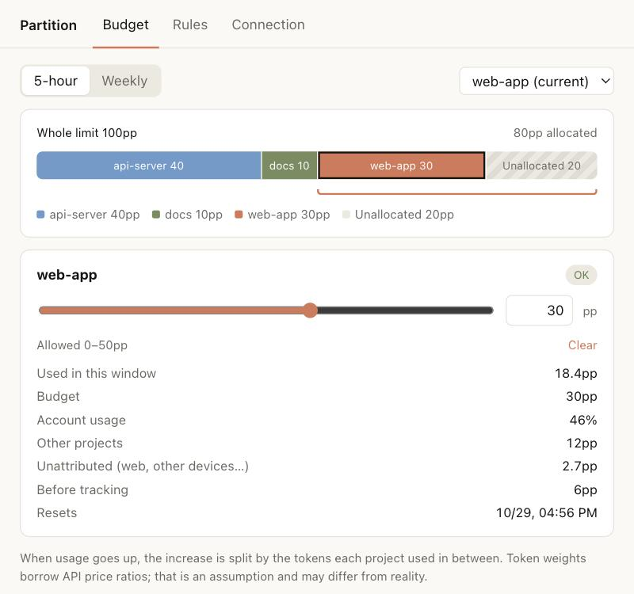

<p align="center">
  
</p>

<h1 align="center">Partition</h1>

<p align="center">
  <em>한도는 하나. 프로젝트는 여럿. 각자 자기 몫만큼.</em>
</p>

<p align="center">
  
  
  
  
  
</p>

<p align="center">
  <picture>
    <source media="(prefers-color-scheme: dark)" srcset="../assets/settings-dark.jpg">
    
  </picture>
</p>

<p align="center">
  <strong>Claude Code의 5시간·주간 한도를 프로젝트마다 나눠 줍니다.</strong><br>
  <strong>선에 가까워지면 경고하고, Claude에게 마무리를 시키고, 그 프로젝트를 멈춥니다.</strong><br>
  <sub>다른 프로젝트는 계속 일합니다.</sub>
</p>

<p align="center">
  <sub><a href="../README.md">English</a></sub>
</p>

---

다들 겪어봤을 겁니다. 프로젝트 세 개를 열어 두었는데, 그중 하나가 긴 리팩터링을 하다가 오후에 5시간 한도를 100% 채웁니다. 나머지 둘은 저녁까지 기다립니다.

요금제 한도는 모든 작업이 같이 쓰는 하나의 통입니다. Partition은 컨테이너마다 메모리를 떼어 주듯 그 통을 나눕니다. `web-app`에 30%p, `api-server`에 40%p를 주면, `web-app`이 30을 다 썼을 때 `web-app`만 멈춥니다. `api-server`에는 40이 그대로 남아 있습니다.

## 숫자

왜 %로 예산을 잡는지, 왜 일찍 개입해야 하는지. 만든 사람의 Codex 기록(세션 119개, 요청 1,381개, 요청당 변화를 잴 수 있었던 건 300개)에서 직접 잰 값입니다. Claude Code 기록이 아닙니다.

| | 중앙값 | p90 | 최대 |
| --- | --- | --- | --- |
| **요청 하나**가 쓴 5시간 한도 | 0% | 9% | **91%** |
| 단계 사이에 오른 5시간 한도 | 1% | 3% | 25% |

- **요청 하나가 한도 대부분을 쓸 수도 있습니다.** 100%를 기다리면 늦습니다. 그래서 그 전에 개입합니다.
- **1%당 토큰이 모델마다 약 6배 달랐습니다**(약 4만~23만). 토큰으로 예산을 잡으면 모델마다 의미가 달라지므로, 한도 자체의 %p로 잡습니다.
- **단계마다 보통 1~3%씩 오릅니다.** 그래서 기본값으로 예산 **3%p** 앞에서 마무리를 시킵니다.

방법과 한계: [docs/usage-analysis.md](../docs/usage-analysis.md)

## 쓰기 전 / 쓴 후

예시: `web-app`에 5시간 한도 30%p를 준 경우

| | Partition 없이 | Partition 있으면 |
| --- | --- | --- |
| `web-app` 24%p | 계속 진행 | 한 번 경고 |
| `web-app` 27%p | 계속 진행 | Claude에게 하던 작업만 끝내고 남은 일을 정리하라고 지시 |
| `web-app` 30%p | 한도 전체를 다 쓸 때까지 계속 | `web-app`의 새 요청과 도구 실행 차단 |
| `api-server` | 리셋까지 대기 | 자기 몫 40%p가 그대로 |

## 동작 방식

```
 status line            hooks
 ───────────            ─────
 응답이 올 때마다         요청·도구 실행 직전마다
   │                      │
   ├─ rate_limits 읽기     ├─ /partition:* 명령? → 직접 처리, AI 호출 없음
   ├─ 기록 파일의 새 토큰   ├─ 예산의 80%   → 한 번 경고
   │  읽기                 ├─ 3%p 앞      → 마무리 지시
   └─ 오른 만큼을 토큰     ├─ 예산 도달    → 차단
      비중대로 나눔        └─ 값 없음·오류 → 통과
```

1. **status line이 사용률을 봅니다.** Claude Code는 응답마다 status line에 `rate_limits`(5시간·주간 %, 리셋 시각)를 넘겨줍니다. hook에는 이 값이 오지 않아서 status line이 `~/.partition/`에 저장해 둡니다.
   데스크톱 앱 Code 탭은 status line을 실행하지 않습니다. 그래서 거기서는 응답이 끝날 때마다 백그라운드 `Stop` hook이 `claude -p "/usage"`를 실행해 같은 사용률을 받습니다. AI를 부르지 않아 토큰 0이고, 재보니 1~2초 걸렸습니다.
2. **오른 만큼을 토큰 비중대로 나눕니다.** status line은 세션 기록 파일의 새 줄도 읽어 그 프로젝트의 대기분에 토큰을 더합니다. 계정 사용률이 오르면 각 프로젝트가 대기분 비중만큼 가져갑니다.
3. **hook이 판단합니다.** 요청과 도구 실행 직전마다 프로젝트 몫을 예산과 비교합니다.

정확하진 않지만, 솔직합니다.

- **스스로 지키는 제한입니다.** 실제 한도는 Anthropic 서버가 관리합니다. Partition은 내 컴퓨터에서 세고 스스로 멈춥니다.
- **한 단계만큼 넘칠 수 있습니다.** 응답과 도구 실행 사이에서 동작하고, 하나가 진행되는 중간에는 멈추지 못합니다.
- **토큰 가중치는 가정입니다.** 입력 1, 캐시 생성 1.25, 캐시 읽기 0.1, 출력 5. API 가격 비율을 빌렸습니다. `~/.partition/config.json`에서 바꿀 수 있습니다.
- **어디서 썼는지 모르는 사용은 그렇게 표시합니다.** 웹이나 다른 기기에서 쓴 양은 *미귀속*, 추적 시작 전 사용은 *추적 전*으로 따로 보여줍니다.
- **확실하지 않으면 통과시킵니다.** 값이 아직 없을 때, 창이 리셋됐을 때, Partition에 오류가 났을 때는 막지 않습니다. Partition 자신의 명령도 막지 않습니다.

## status line

```
[web-app 18.4/30%p · 5h 46%]
```

`web-app`이 30%p 중 18.4%p를 썼고, 계정 전체로는 5시간 한도의 46%를 썼다는 뜻입니다. 주간 예산이 있으면 `· 7d 9/20%p`가 붙습니다. 원래 쓰던 status line이 있으면 그대로 실행되고 Partition이 옆에 붙습니다.

## 설치

**Claude Code**에서, 두 번에 나눠 입력합니다.

```
/plugin marketplace add hyuksanglee/partition
```
```
/plugin install partition@partition
```

그다음 status line을 연결합니다.

```
/partition:setup
```

플러그인은 status line을 직접 설정할 수 없어서, 이 단계에서 `~/.claude/settings.json`의 `statusLine`을 바꿉니다. Claude가 바꿀 내용을 먼저 보여주고, 승인해야만 적용합니다.

이제 지금 있는 프로젝트에 몫을 줍니다.

```
/partition:budget 30
```

**Pro 또는 Max** 요금제(사용률 값은 구독자에게만 옵니다), **Node.js 18 이상**, macOS 또는 Linux가 필요합니다. 데스크톱 앱에서는 `claude` 명령도 설치돼 있어야 합니다(`PATH` 또는 `~/.local/bin`).

## 명령

| 명령 | 하는 일 |
| --- | --- |
| `/partition:ui` | 설정 창 열기. 한도 전체를 막대 하나로, 프로젝트별 몫과 남은 여유를 보여줍니다. 끌어서 바꾸고, 손을 떼면 저장됩니다. |
| `/partition:status` | 이 프로젝트의 사용량과 예산, 다른 프로젝트, 미귀속 사용, 리셋 시각 |
| `/partition:budget <0-100 \| off> [--week]` | 이 프로젝트의 5시간 한도 몫을 정합니다. `--week`를 붙이면 주간 한도 |
| `/partition:setup` | status line 연결. 바꿀 내용을 먼저 보여줍니다. |

`ui`, `status`, `budget`은 AI를 부르기 전에 hook이 답합니다. **토큰 0**입니다. 답이 "operation blocked by hook" 아래에 표시되는데, 원래 그렇게 동작하는 것이고 오류가 아닙니다.

프로젝트는 지금 있는 git 저장소의 최상위 폴더이고, git 저장소가 아니면 그 폴더입니다.

같은 명령을 터미널에서도 토큰 없이 쓸 수 있습니다: `node <플러그인 폴더>/src/cli.mjs help`

## FAQ

**정말 요금제 한도를 나누나요?**
아니요. 한도는 Anthropic 쪽에서 하나로 관리됩니다. Partition은 내 컴퓨터에서 프로젝트별로 세고, 자기 몫을 다 쓴 프로젝트를 멈춥니다.

**정확히 30%p에서 멈추나요?**
아니요. 단계 사이에서 동작하므로 응답이나 도구 실행 하나만큼 넘을 수 있습니다. 3%p 앞의 마무리 단계가 그 차이를 줄이려고 있습니다.

**Partition이 고장 나면요?**
통과시킵니다. 값이 없거나, 창이 리셋됐거나, Partition에 오류가 나도 막지 않습니다.

**데이터를 밖으로 보내나요?**
아니요. 전부 `~/.partition/`에만 있습니다.

**Claude 데스크톱 앱에서도 되나요?**
명령과 hook은 됩니다. Code 탭은 status line을 실행하지 않아서, 대신 응답이 끝날 때마다 `claude -p "/usage"`로 사용률을 읽습니다. 이 출력은 사람이 읽는 문장이라, 문구가 바뀌면 Partition은 그곳에서 사용량을 세지 못하고 고쳐질 때까지 모두 통과시킵니다.

**Codex는요?**
나중에. Codex도 같은 5시간·주간 사용률을 기록하므로 계획에 있습니다.

**어떻게 지우나요?**
`/partition:ui` → **연결** → **원래대로**를 누르면 원래 status line으로 돌아갑니다. 그다음 `/plugin uninstall partition@partition`, 원하면 `~/.partition/`도 지우세요.

**왜 이름이 Partition인가요?**
디스크 크기는 하나지만, 우리는 파티션마다 몫을 정해 줍니다.

## 상태

실험 단계입니다. Claude Code 2.1.312, Pro 요금제에서 확인했습니다(2026-10-29).

- [x] 터미널의 대화형 모드와 `claude -p`에서 `/partition:*` 명령은 AI보다 hook이 먼저 처리합니다.
- [x] status line에 실제 `rate_limits` 값이 들어옵니다.
- [x] 한 번의 테스트에서 Claude가 마무리 지시를 따라 새 작업을 시작하지 않았습니다.
- [x] 데스크톱 앱 Code 탭에서도 `/partition:*` 명령을 hook이 처리합니다.
- [x] Code 탭은 커스텀 status line을 **실행하지 않습니다** (`settings.json`에 연결했지만 실행되지 않음).
- [x] `claude -p "/usage"`는 토큰 0으로 5시간·주간 사용률을 돌려줍니다.
- [ ] Code 탭 안에서 Partition의 백그라운드 `Stop` hook이 그 값을 받는지
- [ ] 프로젝트별 배분이 실제 사용과 얼마나 맞는지

결과나 문제는 [Issues](https://github.com/hyuksanglee/partition/issues)에 알려 주세요.

## 개발

```bash
npm install          # 개발용: 타입 검사용 TypeScript
npm test
npm run typecheck
claude --plugin-dir .
```

순수 JavaScript, 런타임 의존성 없음, 빌드 없음. 설계 문서: [docs/DESIGN.md](../docs/DESIGN.md)

## 라이선스

[MIT](../LICENSE). 각자 자기 몫만큼.
